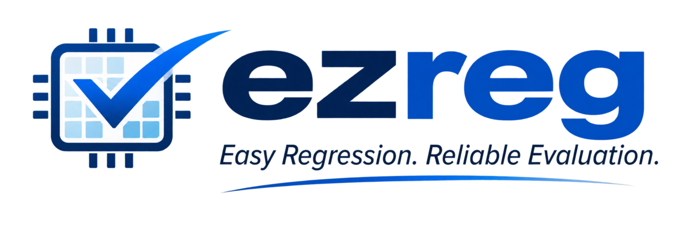

# ezreg

Version: see [`VERSION.md`](VERSION.md)

An Easy-to-Use General-purpose Regression and Evaluation Framework for eFPGA EDA & design tools.

Ezreg is not designed for single EDA tool, but for all the EDA tools with 

- a command-line interface
- accept scripts to run

Ezreg offers

- Regression testcase definition with
  - highly flexibility on run scripts and tool command-line options
  - customization on pass and *Quality-of-Result* (QoR) requirements
  - customizable dependencies on each other

- Regression run with 

  - custom task selection
  - Automatic workspace setup
  - Multi-process execution on tasks
  - Log parsing and error checks

- QoR tracking with

  - Automatic extract QoR metrics from logs and reports (fully customizable by users)
  - Automatic compare golden results and apply Qor check with custmizable tolerance
  - Automatic update golden results on selected tasks in one shot

## Documentation

Full documentatation can be found [here](https://ezreg.readthedocs.io/en/latest/)

## Developer Guidelines

Please read the [contributor_guidelines](https://ezreg.readthedocs.io/en/latest/developer/contributor_guidelines/) if you would like to contribute to the project.
